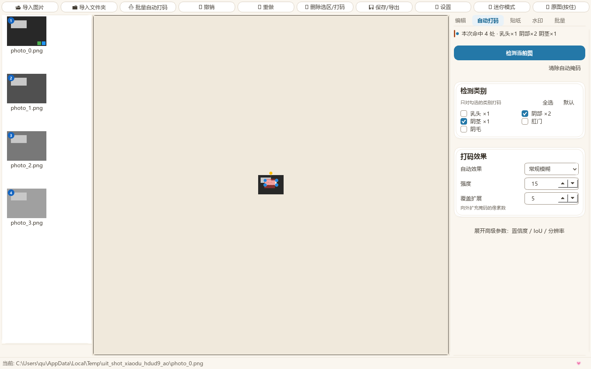

# Unified Image Tool

Windows 桌面版**批量打码 / 马赛克**工具：用本地 ONNX 分割模型自动识别敏感区域，再用手动工具补刀，最后一键批量导出。**全程离线，不上传任何图片。**



## 下载（推荐）

不需要装 Python：到 [Releases](https://github.com/duxingz/unified-image-tool/releases) 下载 `UnifiedImageTool.zip`（约 187MB，已含两个模型），解压到**普通文件夹**（例如 `D:\UnifiedImageTool\`），双击 `UnifiedImageTool.exe`。

> ⚠️ 不要放在 `C:\Program Files` 这类没有写权限的位置；`_internal` 文件夹必须和 exe 放在一起、不要改名。
> ⚠️ 同一时间只能运行一个实例。

- 系统：Windows 10 / 11（x64）
- 显卡：有独显走 DirectML 加速，没有会自动回退 CPU（慢一些但可用）
- 首次启动会在 `%APPDATA%\AutomaticCoding2\` 生成配置

## 功能

- **自动打码**：ONNX 分割检测，可选模糊 / 黑线 / 白雾 / 光效 / 像素块马赛克，支持「覆盖扩展」与置信度 / IoU / 检测分辨率调节
- **手动补齐**：画笔、矩形、套索、橡皮擦（橡皮擦对自动+手动结果实时生效，所见即所得）
- **批量**：整文件夹导入、逐图编辑、批量转格式 / 缩放 / 重命名 / 水印
- **水印**：图片素材与文字水印，九宫格锚点、大小与不透明度可调
- **导出**：统一对话框，可选格式 / 质量 / 缩放 / 命名方式 / 去除元数据；未编辑的图走字节级快速拷贝保证画质
- **主题**：「小独爱心 / 小独夜」两套

## 从源码运行

需要 Python 3.12（本项目在 3.12 上开发）：

```powershell
python -m pip install -r requirements.txt
python run.py
```

模型不入库（共约 88MB）。两种办法：

1. 直接把两个 `.onnx` 放进 `models/`（见 [`models/README.md`](models/README.md)）；
2. 或者用 Release 包里的 `_internal/models/`。

## 打包

```powershell
一键打包zip.bat
```

等价于 `PyInstaller --noconfirm UnifiedImageTool.spec` + `scripts\打包zip.ps1`。
产物：`dist\UnifiedImageTool\UnifiedImageTool.exe` 与 `UnifiedImageTool.zip`。

## 测试与自检

```powershell
python -m pytest tests -q -n 8      # 376 个用例
python scripts\selfcheck.py         # 独立全流程自检（88 项）
python scripts\render_ui.py         # 把每个界面渲染成 PNG 到 _ui_shots（UI 回归用）
```

## 目录

```
app/           主程序（core 处理链 / ui 界面 / assets 资源）
tests/         pytest 用例
scripts/       打包、自检、UI 渲染
docs/          截图
models/        模型放置说明（.onnx 不入库）
run.py         源码启动入口
UnifiedImageTool.spec  PyInstaller 配置
```

## 说明

- 仓库为**源码**仓库：`models/`、构建产物、个人素材（`app/stickers/`）、渲染输出（`_ui_shots/`）均已忽略；可执行版请用 Release 资产。
- 界面基于「小独爱心」设计系统（暖白 / 天蓝 / 蜜橙 / 心粉四色）。
- 仅供个人处理自己的图片使用，请遵守所在地区法律与平台规则。
